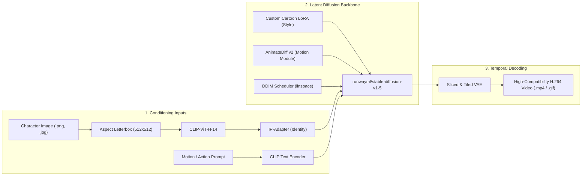

# 🎬 Cartoon Video Generator (Image-to-Cartoon-Video AI Studio)

[](LICENSE)
[](demo_inference.ipynb)
[](train_lora_colab.ipynb)
[](https://huggingface.co/spaces)
[](https://www.python.org/)

An end-to-end open-source generative AI pipeline that transforms still character portraits into smooth, stylized cartoon video clips. Engineered for free cloud GPU tiers (Google Colab / Kaggle T4 with 15–16 GB VRAM) and consumer hardware.

---

## 🏗️ Repository Architecture

```text
cartoon-video-generator/
├── app.py                     # Gradio Blocks v4+ web application (Module 4)
├── pipeline.py                # Core video synthesis engine (Module 3)
├── prepare_dataset.py         # Automated dataset curation & auto-captioning (Module 1)
├── train_lora.py              # Memory-optimized LoRA training engine (Module 2)
├── train_lora_colab.ipynb     # 1-Click cloud training notebook on Colab T4
├── demo_inference.ipynb       # 1-Click interactive inference demo notebook
├── requirements.txt           # Unified pinned Python dependencies
├── Dockerfile                 # Production CUDA container configuration
├── LICENSE                    # Permissive Apache 2.0 license
├── custom.css                 # Polished dark/light responsive UI styling
├── assets/
│   └── examples/              # Preset character portrait examples
└── tests/                     # 37 unit and integration test cases
```

---

## 🔬 How It Works: The Two-Stage Architecture

The pipeline decouples **character identity**, **visual art style**, and **temporal motion** into three specialized adapters layered onto the Stable Diffusion 1.5 U-Net:



1. **Identity Preservation (IP-Adapter)**: Extracts visual tokens via `CLIP-ViT-H-14` and injects them via decoupled cross-attention layers, keeping facial structures and clothing intact without fine-tuning.
2. **Style Transfer (SD 1.5 LoRA)**: A custom low-rank adapter fine-tuned on cartoon/anime still frames enforces cel-shading aesthetics.
3. **Motion Synthesis (AnimateDiff v2)**: Temporal attention blocks model fluid animation across 16–24 frames at 8–12 FPS.

---

## ⚡ Zero-Cost Cloud Optimization Profile

Video diffusion models unpack spatial-temporal latents across 16–24 frames simultaneously, which can trigger Out-Of-Memory (OOM) errors. Our architecture keeps peak VRAM below **8.5 GB**:

| Optimization Layer | Implementation | VRAM Impact |
| :--- | :--- | :--- |
| **Quantized 8-Bit Optimizer** | `bitsandbytes.optim.AdamW8bit` | Reduces optimizer memory by 75% |
| **Gradient Checkpointing** | Recomputes activations during backpropagation | Reduces peak activation memory by 50% |
| **Model CPU Offloading** | `pipe.enable_model_cpu_offload()` | Keeps idle pipeline modules in system RAM (~6.5 GB peak) |
| **Sliced & Tiled VAE** | `enable_vae_slicing()` + `enable_vae_tiling()` | Decodes video frames sequentially, capping VAE memory |
| **Sequential Offloading** | `--low_vram` flag | Swaps layers individually for GPUs with $< 8$ GB VRAM |

---

## 🚀 Quickstart Guide

### Option 1: One-Click Interactive Colab Demo
Click the badge at the top or open [`demo_inference.ipynb`](demo_inference.ipynb) to launch a free interactive demo with a public tunnel directly on a Google Colab T4 GPU.

---

### Option 2: Local Python Virtual Environment

```bash
# 1. Clone the repository
git clone https://github.com/irshadmansuri046/VideoCreator.git
cd VideoCreator

# 2. Create and activate a virtual environment
python3 -m venv venv
source venv/bin/activate

# 3. Install dependencies
pip install -r requirements.txt

# 4. (Recommended) Pre-download model weights (~8 GB) with live progress bars
python3 download_models.py

# 5. Launch the web application
python3 app.py
```
Open **`http://localhost:7860`** in your browser.

> [!TIP]
> **Apple Silicon Mac & Low-Memory Machines:** The pipeline automatically detects Apple Silicon MPS (Metal) and activates `torch.float16` with `slice_size=1` attention slicing and VAE slicing. Use the default 8–12 frames and 15 steps for fast clips (~60s generation time).

---

### Option 3: Containerized Deployment via Docker

```bash
# 1. Build the Docker image
docker build -t cartoon-video-generator .

# 2. Run container with GPU access
docker run --gpus all -p 7860:7860 -it cartoon-video-generator
```

---

## 🎨 Training Your Custom Cartoon Style LoRA

To fine-tune a custom cartoon style from your own image or video collection:

### Step 1: Curate & Auto-Caption Dataset (Module 1)
```bash
python3 prepare_dataset.py \
    --input_dir ./raw_cartoons \
    --output_dir ./curated_dataset \
    --trigger_word "in cartoon artstyle," \
    --fps 1.0 \
    --batch_size 8
```

### Step 2: Train Memory-Optimized LoRA (Module 2)
```bash
accelerate launch train_lora.py \
    --dataset_dir ./curated_dataset \
    --output_dir ./my_cartoon_lora \
    --trigger_word "in cartoon artstyle," \
    --lora_rank 16 \
    --lora_alpha 16 \
    --train_batch_size 1 \
    --gradient_accumulation_steps 4 \
    --learning_rate 1e-4 \
    --max_train_steps 1500 \
    --mixed_precision "fp16" \
    --use_8bit_adam \
    --gradient_checkpointing
```

### Step 3: Run Inference with Your Trained LoRA (Module 3 & 4)
```bash
# Terminal CLI synthesis
python3 cli_test.py \
    --image ./character.png \
    --lora_path ./my_cartoon_lora \
    --output ./animated_character.mp4

# Or launch Web App with custom LoRA
python3 app.py --lora_path ./my_cartoon_lora
```

---

## 🧪 Automated Testing

Verify all four modules with the comprehensive 37-test suite:
```bash
python3 -m unittest discover -s tests -p "test_*.py" -v
```

---

## 📚 Attributions & Acknowledgments

This project builds upon the foundational research and open-source contributions of:
* **[AnimateDiff](https://github.com/guoyww/AnimateDiff)**: Guo et al., *AnimateDiff: Animate Your Personalized Text-to-Image Diffusion Models without Specific Tuning*.
* **[IP-Adapter](https://github.com/tencent-ailab/IP-Adapter)**: Ye et al., *IP-Adapter: Text Compatible Image Prompt Adapter for Text-to-Image Diffusion Models*.
* **[Stable Diffusion](https://github.com/runwayml/stable-diffusion)**: Rombach et al., *High-Resolution Image Synthesis with Latent Diffusion Models*.
* **[Hugging Face Diffusers & PEFT](https://github.com/huggingface/diffusers)**: For modular diffusion pipelines and parameter-efficient fine-tuning tools.
